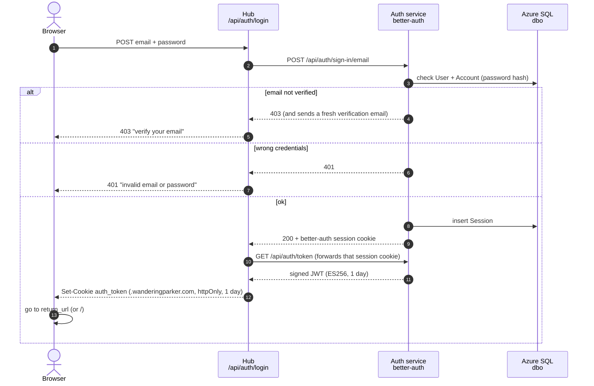
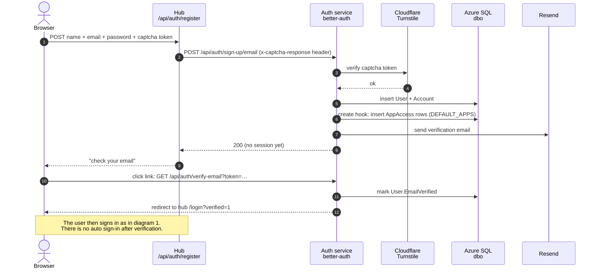
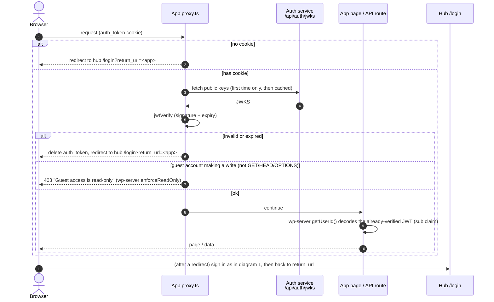
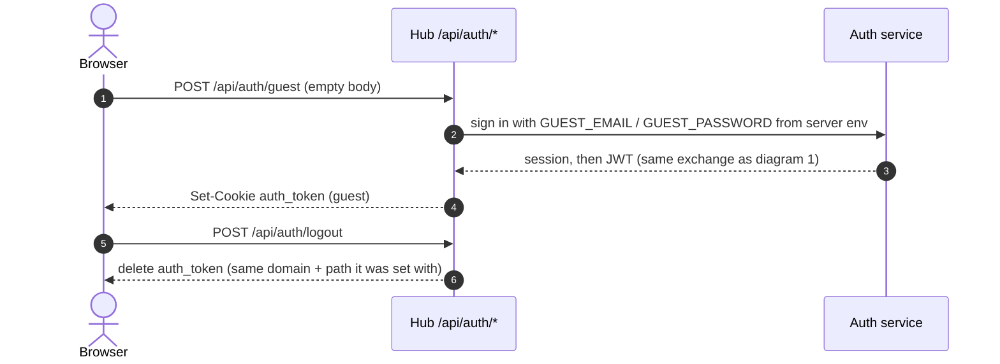

# Auth Flow

The browser never talks to better-auth directly to sign in. The hub's
`app/api/auth/*` routes make the calls server-to-server, exchange the auth
service's session for a signed JWT, and set that JWT as the `auth_token` cookie on
`.wanderingparker.com`. From then on every project checks the cookie itself, using
the auth service's public keys (JWKS).

- **Token:** ES256 JWT that lasts 1 day. The cookie's `maxAge` matches it, and
  there is no refresh, so an expired token means signing in again.
- **Cookie:** `httpOnly`, `sameSite=lax`, `secure` in production, and set on
  `.wanderingparker.com` in production so every subdomain gets it.

## 1. Sign in

The better-auth session cookie stays with the hub's server-side call. The browser
only ever holds `auth_token`.

## 2. Sign up and verify email

Password reset works the same way. The hub's `/api/auth/forgot-password` calls
`/request-password-reset`, Resend emails a link back to the hub's `/reset-password`
page, and that page posts the new password through `/api/auth/reset-password`.

## 3. Visiting a page in an app

The same flow runs for the hub's own pages and for each child app. The hub's
version redirects to its own `/login`, and the child apps send people to the hub's
`/login` with a `return_url`.

## 4. Guest sign-in and sign-out

## App access (AppAccess)

The auth service writes the grants, but each project decides whether to check them:

| Project | Checks `dbo.AppAccess`? | How |
|---|---|---|
| Hub | Yes, for display | `GET /api/user/apps` with the JWT as Bearer; hides cards for apps you don't have |
| no-file-no-mile | Yes, blocks access | `lib/auth.ts` `resolveAthleteAccess` runs from the layout and sends ungranted users back to the hub |
| sharpener | No | a valid JWT is enough |
| fly-fishing-tracker | No | a valid JWT is enough |

So in sharpener and fly-fishing-tracker, a signed-in user without a grant can still
reach the app by typing its URL. This is recorded here, not fixed, under #50.

## Not shown

- **Dev bypass:** when `DISABLE_AUTH=true` and the build isn't production, each
  `proxy.ts` lets every request through, and wp-server's `getUserId()` returns the
  guest's id (`32`). A production build can't turn it on, whatever the env var
  says.
- **Rate limits** (better-auth, production only): sign-up 5 per minute, sign-in 10
  per minute, password reset requests 5 per minute.
- **Contact Me** also uses the auth service and Turnstile, but it has nothing to do
  with identity. See the system overview.
