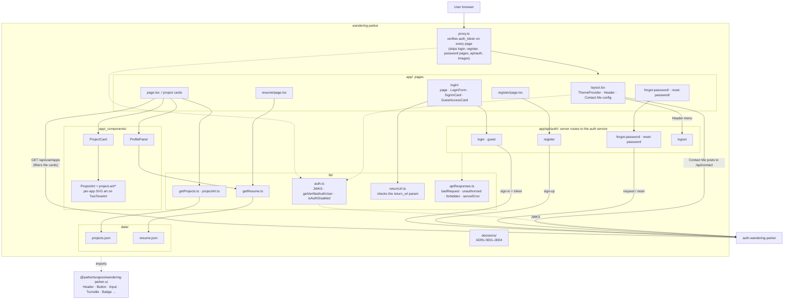

# Hub Organization

`wandering-parker` is a Next.js 16 / React 19 App Router project. It is the landing
page (project cards and résumé) and the only sign-in UI for the whole site. It has
no database. Its content comes from local JSON, and everything about users goes
through the auth service.

## How the folders split the work

| Folder | Role |
|---|---|
| `proxy.ts` | Next 16's request interceptor (it used to be `middleware.ts`). It runs before every page except the public sign-in pages, checks the JWT, and redirects to `/login` if it's missing or bad. |
| `app/` | Pages, one folder per route. They are server components unless they need browser state. The sign-in and password forms are client components. |
| `app/api/auth/` | The hub's own backend. These are the only places the hub talks to better-auth's sign-in, sign-up and password endpoints, and they set or clear the `auth_token` cookie. |
| `app/_components/` | Components used only by the hub. The leading `_` keeps Next from treating the folder as a route. Shared components come from wp-ui instead. |
| `lib/` | Plain TypeScript with no JSX: auth checks, data loaders and response helpers. |
| `data/` | The card and résumé content, edited by hand and bundled at build time. |
| `decisions/` | Architecture Decision Records: why each choice was made. |

## Notes

- **Two places check the token, on purpose.** `proxy.ts` guards the protected pages.
  `layout.tsx` calls `getVerifiedAuthUser` again because the layout also renders on
  the public pages that the proxy skips, and the Header still needs to know who is
  signed in there.
- **Only the home page asks the auth service for data at render time**
  (`/api/user/apps`). Everything else on the page comes from `data/*.json`.
- `lib/returnUrl.ts` is new and not yet committed. This diagram assumes it lands.
