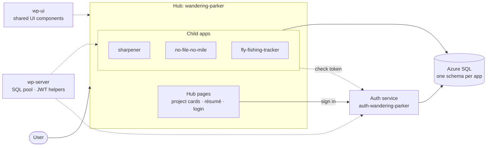

# System Overview

The hub and each app deploy as their own Vercel subdomain under
`wanderingparker.com`. Sign-in goes through the auth service, and one JWT cookie
works across every subdomain. All projects share two `@parkerburgess` packages,
and each one stores its data in its own schema on one Azure SQL database.

## Reading it

- **Solid arrow:** a request or data flow.
- **Dotted arrow:** a token check against the auth service's public keys, or a
  shared package that a project imports.

## Details left out of the diagram

- **Nesting:** the child apps are drawn inside the hub because people reach them
  from the hub's project cards. In code they're separate repos, each deployed to
  its own subdomain.
- **Database schemas:** the auth service owns `dbo` (users, sessions, signing keys,
  `AppAccess`). The apps use `sharpener`, `training` (no-file-no-mile) and
  `flyfishing`. The hub has no database. Its cards and résumé come from
  `data/*.json`.
- **Shared packages:** wp-ui (Header, nav, Contact Me, theme) is used by the hub and
  every app. wp-server (SQL pool, JWT helpers, guest read-only guard) is used by
  the apps and the auth service, but not the hub.
- **Outside services:** sharpener calls Claude to generate questions,
  no-file-no-mile pulls activities from Strava, and the auth service sends email
  through Resend and checks captchas with Cloudflare Turnstile.
- **Contact Me:** the form in every header posts straight to the auth service's
  `/api/contact` (decision 0003).
- **Not shown:** `wp-ui-gallery`, a dev-only showcase for wp-ui components, and
  the retired apps in `Apps Unused`. The auth service still grants every new user
  access to `good-bad-calendar` (`DEFAULT_APPS`).

For how sign-in actually works, see [Auth flow](auth-flow.md).
